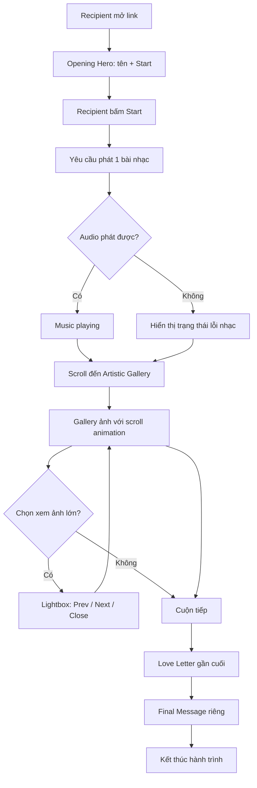
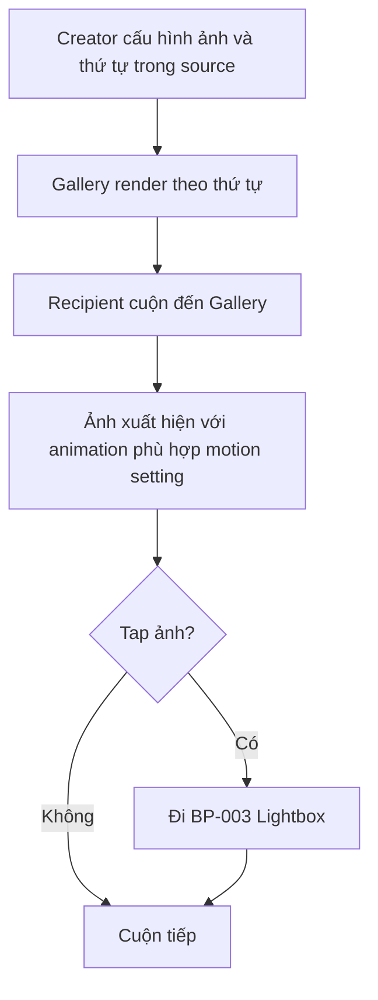
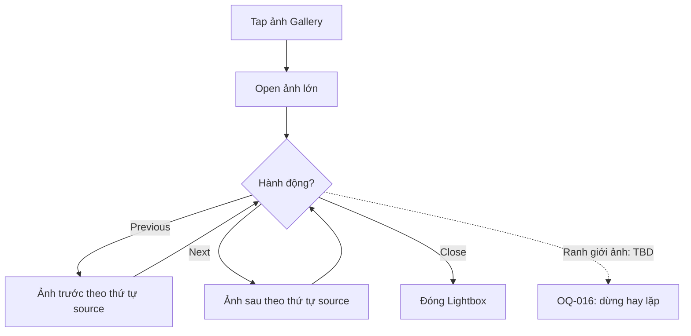
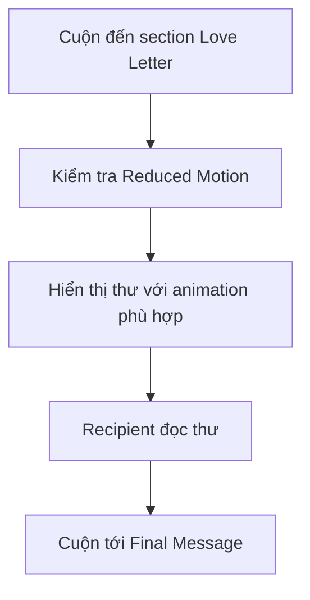
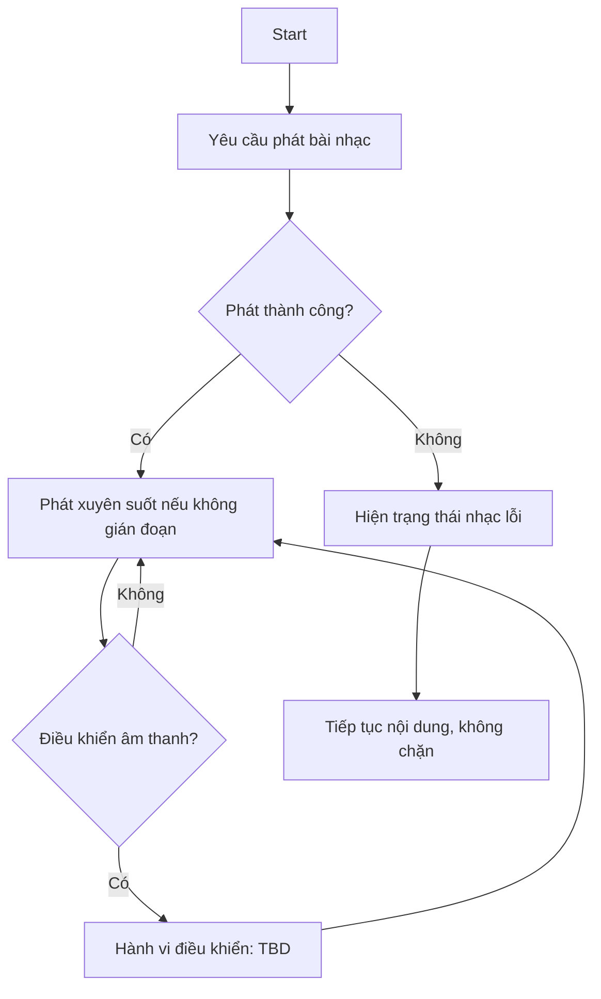
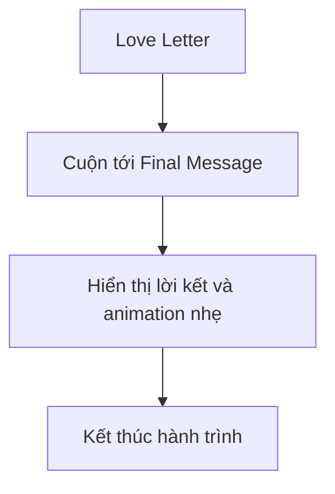
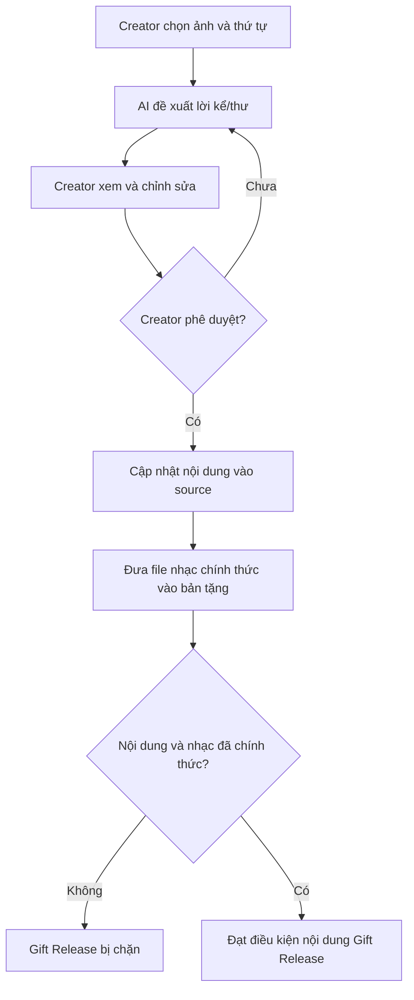
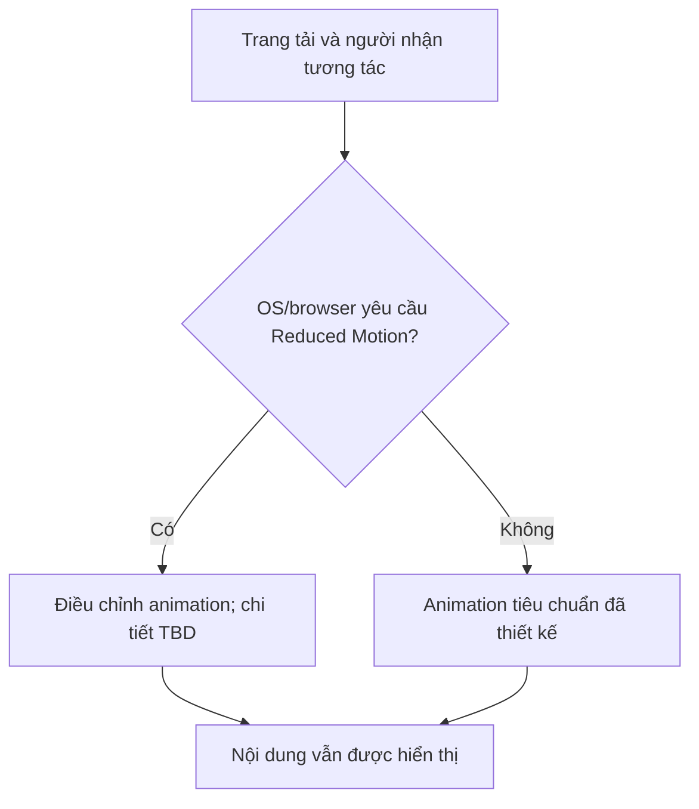

# BUSINESS PROCESS & WORKFLOW

> **Dự án:** Website For My Love  
> **Mã tài liệu:** DOC-03  
> **Phiên bản:** Draft v1.0  
> **Ngày:** 11/10/2026  
> **Nguồn:** Requirement Baseline v0.7 — MVP Scope đã phê duyệt; Proposed/TBD chưa được phê duyệt  
> **Trạng thái:** Draft — chưa ký duyệt tài liệu chi tiết  
> **Mục tiêu:** Mô tả các luồng chính, quyết định, trạng thái và ngoại lệ có thể kiểm chứng.

**Quy ước trạng thái:** `Confirmed` = quyết định đã được người dùng xác nhận; `Proposed` = đề xuất chưa xác nhận; `Assumed` = giả định có nêu lý do; `Open Question/TBD` = cần làm rõ; `Out of Scope` = đã loại khỏi phạm vi; `Superseded` = thông tin đã được thay thế. Việc duyệt MVP **không** tự động duyệt các chi tiết Proposed/TBD.

## Mục lục

- **1.** Business Process Overview
- **2.** Process Inventory
- **3.** Roles & Responsibilities
- **4.** AS-IS Process
- **5.** TO-BE Process
- **6.** Process Flow Diagrams
- **7.** Detailed Workflow Specifications
- **8.** Decision Points
- **9.** Business Rules
- **10.** State Transitions
- **11.** Alternative Flows
- **12.** Exception Flows
- **13.** Process Inputs & Outputs
- **14.** Process Dependencies
- **15.** Open Questions

## 1. Business Process Overview

Website là một hành trình đơn trang của Recipient. Creator chuẩn bị và duyệt nội dung trước Gift Release. Thao tác UX tại runtime được mô tả dưới dạng các Business Process nhỏ để Dev/QA truy vết. **Workflow diagram có các nhánh Proposed được ghi rõ.**

## 2. Process Inventory

| BP ID | Name | Actor | Related Feature | Status |
| --- | --- | --- | --- | --- |
| BP-001 | Main Romantic Experience | Recipient | FEAT-001/002/003/004/005 | Main flow Confirmed; exception Proposed |
| BP-002 | Gallery Discovery | Recipient, Creator (cấu hình) | FEAT-002 | Confirmed core |
| BP-003 | Lightbox Image Viewing | Recipient | FEAT-002 | Confirmed core; boundary TBD |
| BP-004 | Love Letter Reveal | Recipient | FEAT-003 | Confirmed core |
| BP-005 | Background Music & Error | Recipient, Browser | FEAT-004 | Confirmed core/error; controls TBD |
| BP-006 | Final Message Reveal | Recipient | FEAT-005 | Confirmed core |
| BP-007 | Prepare & Approve Gift Content | Creator, AI hỗ trợ | Cross-feature | Confirmed release gate; steps Proposed |
| BP-008 | Reduced Motion Handling | Recipient settings, Browser | Cross-feature | Confirmed principle; effects TBD |

## 3. Roles & Responsibilities

| Role | Responsibility | Boundary |
| --- | --- | --- |
| Recipient | Trải nghiệm website theo link, scroll, tap, audio | Không đăng nhập/duyệt nội dung |
| Creator | Chọn/đặt thứ tự ảnh, phê duyệt nội dung AI đề xuất, cung cấp nhạc | Không yêu cầu admin UI |
| Browser/OS | Thực thi animation, phát media, cung cấp Reduced Motion | Hệ thống ngoài, có thể từ chối audio |

## 4. AS-IS Process

Không có quy trình AS-IS hiện hữu được người dùng mô tả. Bỏ trống có kiểm soát: `AS-IS = Not Applicable / Not Provided`. Không dựng sơ đồ thay thế giả định.

## 5. TO-BE Process

**Confirmed logical order:** mở link → Hero/Start → Gallery (scroll/lightbox) → Love Letter → Final Message. Nhạc bắt đầu được yêu cầu sau Start, chạy xuyên suốt nếu phát được; khi lỗi hiển thị trạng thái và tiếp tục. Reduced Motion áp dụng với animation.

## 6. Process Flow Diagrams

### BP-001 — Main Romantic Experience

**Lưu ý:** Dòng `I → L` biểu diễn người nhận tiếp tục cuộn, không bắt buộc phải mở ảnh lớn. Không xác nhận behavior ở ranh giới Lightbox.

### BP-002 — Gallery Discovery

### BP-003 — Lightbox Image Viewing

### BP-004 — Love Letter Reveal

### BP-005 — Background Music

### BP-006 — Final Message

### BP-007 — Content Preparation / Approval (offline process)

**Các bước thao tác kỹ thuật và thứ tự giữa cập nhật ảnh/nhạc là Proposed; điều kiện Gift Release và quyền duyệt của Creator là Confirmed.**

### BP-008 — Reduced Motion

## 7. Detailed Workflow Specifications

### BP-001 — Tạo hành trình món quà xuyên suốt

| Thuộc tính | Giá trị |
| --- | --- |
| Trigger | Mở link + Start |
| Actors | Recipient |
| Preconditions | Truy cập link; website tải được |
| Main Flow | Hero → Start → Gallery → Love Letter → Final |
| Alternative Flow | Bỏ xem Lightbox; cuộn trực tiếp |
| Exception Flow | Music error -> hiện lỗi vẫn tiếp tục; ảnh lỗi TBD |
| Decision Rules | Một trang, thứ tự section; Start trước nhạc |
| Postconditions | Final Message đã hiển thị |
| Related Features | FEAT-001/002/003/004/005 |

### BP-002 — Xem ảnh theo thứ tự đã cấu hình

| Thuộc tính | Giá trị |
| --- | --- |
| Trigger | Cuộn vào Gallery |
| Actors | Recipient; Creator (cấu hình) |
| Preconditions | Bộ ảnh được cấu hình |
| Main Flow | Render thứ tự → scroll animation → xem ảnh |
| Alternative Flow | Không mở ảnh lớn |
| Exception Flow | Ảnh tải lỗi chưa chốt |
| Decision Rules | Không Timeline; 10–30 dự kiến; thứ tự source |
| Postconditions | Ảnh có thể khám phá |
| Related Features | FEAT-002 |

### BP-003 — Xem ảnh lớn và điều hướng

| Thuộc tính | Giá trị |
| --- | --- |
| Trigger | Chạm ảnh |
| Actors | Recipient |
| Preconditions | Ảnh tồn tại trong Gallery |
| Main Flow | Open → Previous/Next hoặc Close |
| Alternative Flow | Chỉ mở và đóng |
| Exception Flow | Chuyển ở ảnh đầu/cuối TBD; vuốt TBD |
| Decision Rules | Thứ tự source |
| Postconditions | Trở lại trạng thái Gallery |
| Related Features | FEAT-002 |

### BP-004 — Hiển thị thư tình

| Thuộc tính | Giá trị |
| --- | --- |
| Trigger | Cuộn đến thư |
| Actors | Recipient |
| Preconditions | Section Love Letter có nội dung |
| Main Flow | Xuất hiện thư → đọc → cuộn tiếp |
| Alternative Flow | Không cần thao tác mở phong bì |
| Exception Flow | Nội dung chưa duyệt là release blocker, không chặn Dev Draft |
| Decision Rules | Thư trước lời kết; Reduced Motion |
| Postconditions | Thư được đọc/hiển thị |
| Related Features | FEAT-003 |

### BP-005 — Điều khiển âm thanh không chặn nội dung

| Thuộc tính | Giá trị |
| --- | --- |
| Trigger | Start, thao tác audio |
| Actors | Recipient; Browser |
| Preconditions | Một nguồn nhạc được cấu hình |
| Main Flow | Yêu cầu phát → chơi → điều khiển |
| Alternative Flow | Người nhận không bật được nhạc vẫn cuộn |
| Exception Flow | Phát lỗi → trạng thái lỗi, vẫn dùng web |
| Decision Rules | Một bài; cơ chế điều khiển TBD |
| Postconditions | Âm thanh playing/paused/error đề xuất |
| Related Features | FEAT-004 |

### BP-006 — Hiển thị lời nhắn kết

| Thuộc tính | Giá trị |
| --- | --- |
| Trigger | Cuộn tới phần sau thư |
| Actors | Recipient |
| Preconditions | Love Letter xuất hiện trước |
| Main Flow | Final Message xuất hiện animation nhẹ |
| Alternative Flow | Không cần nút replay |
| Exception Flow | Chưa có nội dung chính thức: release blocker |
| Decision Rules | Hai section riêng |
| Postconditions | Kết thúc nội dung chính |
| Related Features | FEAT-005 |

### BP-007 — Phê duyệt nội dung trước Gift Release

| Thuộc tính | Giá trị |
| --- | --- |
| Trigger | Chuẩn bị bản tặng |
| Actors | Creator; AI hỗ trợ |
| Preconditions | Đã có ảnh; nội dung và nhạc chưa đủ |
| Main Flow | AI draft → Creator duyệt → đưa vào source → kiểm tra nhạc |
| Alternative Flow | Sửa bản draft nhiều vòng |
| Exception Flow | Thiếu thư hoặc nhạc chính thức → không Gift Release |
| Decision Rules | Placeholder hợp lệ trong Dev; không hợp lệ trước tặng |
| Postconditions | Nội dung chính thức sẵn sàng |
| Related Features | FEAT-001/002/003/004/005 |

### BP-008 — Phản hồi Reduced Motion

| Thuộc tính | Giá trị |
| --- | --- |
| Trigger | OS/browser motion preference |
| Actors | Recipient; Browser |
| Preconditions | Website đang chạy |
| Main Flow | Đọc setting → chọn reduced/normal animation |
| Alternative Flow | Không yêu cầu chế độ giảm |
| Exception Flow | Loại giảm và fallback TBD |
| Decision Rules | Không che giấu nội dung chính khi giảm |
| Postconditions | Hiển thị phù hợp cài đặt |
| Related Features | Cross-cutting |

## 8. Decision Points

| Decision | Options | Confirmed / TBD |
| --- | --- | --- |
| D-001: Start? | Không / Có → yêu cầu phát nhạc | Confirmed |
| D-002: Audio phát? | Có → playing; Không → lỗi + tiếp tục | Confirmed |
| D-003: Xem ảnh lớn? | Không → cuộn; Có → Lightbox | Confirmed |
| D-004: Lightbox ảnh đầu/cuối? | Không lặp / lặp | TBD (Proposed không lặp) |
| D-005: Reduced Motion? | On → điều chỉnh animation; Off → normal | Confirmed principle; detail TBD |
| D-006: Nội dung và nhạc official? | Không → không Gift Release; Có → đạt gate nội dung | Confirmed |

## 9. Business Rules

| Rule ID | Quy tắc | Status | Related BR |
| --- | --- | --- | --- |
| RULE-001 | Link không công bố; người có link truy cập được, không có cơ chế xác thực đã được yêu cầu | Confirmed | BR-002 |
| RULE-002 | Nội dung website cố định trong source; không yêu cầu dữ liệu timeline ngày tháng | Confirmed | BR-004, BR-009, BR-021 |
| RULE-003 | Gallery theo thứ tự cấu hình thủ công; số lượng 10–30 chỉ là dự kiến | Confirmed | BR-018, BR-031 |
| RULE-004 | Love Letter đứng trước Final Message, mỗi phần là một section | Confirmed | BR-019, BR-024 |
| RULE-005 | Một bài nhạc bắt đầu sau Start, có điều khiển người nhận; nhạc lỗi vẫn tiếp tục và báo trạng thái | Confirmed cấp cao | BR-012, BR-015, BR-032 |
| RULE-006 | Trước Gift Release phải có nội dung đã được chốt và nhạc chính thức; khi Dev có thể dùng placeholder | Confirmed | BR-029, BR-030 |
| RULE-007 | Animation điều chỉnh theo Reduced Motion của OS/browser | Confirmed cấp cao | BR-013, BR-034 |
| RULE-008 | Tối ưu sản phẩm cho điện thoại, không cần thiết kế riêng tablet/desktop | Confirmed | BR-033 |
| RULE-009 | Chuyển ảnh tới đầu/cuối thì dừng, không vòng lặp | Proposed | FR-011 |
| RULE-010 | Nếu ảnh lỗi, giữ bố cục và thông báo/placeholder phù hợp | Proposed | OQ-018 |

## 10. State Transitions

| Entity | Transitions / nguồn | Status |
| --- | --- | --- |
| Experience | unstarted → started | Proposed state labels; Start Confirmed |
| Lightbox | closed → open ↔ prev/next → closed | Confirmed behaviors; state names Proposed |
| Music | idle → playing OR error; playing → paused/muted TBD | Error path Confirmed; mechanism TBD |
| Motion | normal ↔ reduced theo OS/browser | Confirmed principle; transition details TBD |
| Release content | placeholder → approved → official | Confirmed release gate; state model Proposed |

## 11. Alternative Flows

- **BP-001:** Recipient không mở ảnh lớn và tiếp tục cuộn đến thư — Confirmed khả năng đi tiếp.
- **BP-003:** Recipient đóng Lightbox và tiếp tục xem Gallery — Confirmed ở cấp hành vi.
- **BP-005:** Recipient không điều khiển nhạc và tiếp tục trải nghiệm — Derived từ luồng chính.
- **BP-007:** Creator không duyệt nháp chữ, nội dung được sửa lại — Proposed thao tác lặp; trách nhiệm Creator duyệt Confirmed.

## 12. Exception Flows

| ID | Tình huống | Kết quả được xác nhận / đề xuất | Liên quan |
| --- | --- | --- | --- |
| EX-001 | Nhạc từ chối phát / tải lỗi | Confirmed: hiển thị trạng thái lỗi và tiếp tục | BR-032, US-008 |
| EX-002 | Gallery có ảnh không tải | Proposed: placeholder và vẫn hiển thị bố cục; TBD | OQ-018 |
| EX-003 | Next từ ảnh cuối | Proposed: không vòng lặp; TBD | OQ-016 |
| EX-004 | Reduced Motion bật | Confirmed: hỗ trợ; Proposed: giảm animation trang trí, không giấu nội dung | BR-034, OQ-023 |
| EX-005 | Nhấn Start nhiều lần | Proposed: chống tác động lặp | OQ-024 |
| EX-006 | Chưa có nhạc/thư official khi Gift Release | Confirmed: release không đạt gate nội dung | BR-030 |
| EX-007 | Mở bằng tablet/desktop | Không có cam kết tối ưu riêng; không có yêu cầu chặn | BR-033 |

## 13. Process Inputs & Outputs

| BP | Input | Output | Dependency |
| --- | --- | --- | --- |
| BP-001 | Link; recipientName; Start | Flow started | FEAT-001/004 |
| BP-002 | photos[]; order | Gallery render | Content photos |
| BP-003 | Selected image; order | Photo large / closed | BP-002 |
| BP-004 | Approved/pending letter | Letter rendered | CONTENT-004 |
| BP-005 | Audio file; Start/control | Playing/error state | CONTENT-005, browser |
| BP-006 | Final message | Ending | BP-004 |
| BP-007 | Photos/copy/audio | Official content gate | Creator approval |
| BP-008 | OS setting | Animation variants | Browser support |

## 14. Process Dependencies

**Confirmed:** BP-001 dùng FEAT-001 và FEAT-004; BP-002 dẫn sang BP-003; BP-004 đứng trước BP-006; BP-007 cung cấp nội dung cho Gift Release; BP-008 áp dụng đối với animation của FEAT-001/002/003/005. **Proposed / TBD:** media fallback, cơ chế retry, chi tiết hiệu ứng Reduced Motion. Không phát sinh vai trò chưa được khai báo.

## 15. Open Questions

| OQ | Vấn đề | Tác động | Status | Hành động tiếp theo |
| --- | --- | --- | --- | --- |
| OQ-015 | Cơ chế điều khiển audio: Pause/Resume hay Mute/Unmute? | FEAT-004; US-005 | Open Question | Chốt trước DoR US-005 |
| OQ-016 | Lightbox có lặp từ cuối về đầu? | FEAT-002; US-003 | Proposed không lặp | Chốt trước DoR US-003 |
| OQ-017 | Lightbox có hỗ trợ vuốt trên mobile/Escape? | FEAT-002; US-003 | Proposed có | Không chặn Draft |
| OQ-018 | Ảnh tải lỗi/ảnh sai định dạng hiển thị thế nào? | FEAT-002; US-002 | Proposed placeholder lỗi | Chốt trước QA |
| OQ-019 | Thiết bị mobile, trình duyệt và viewport kiểm thử? | NFR-001 | TBD | Chốt trước QA |
| OQ-020 | Ngưỡng định lượng cho độ mượt/tốc độ tải? | NFR-002 | TBD | Chốt trước QA |
| OQ-021 | Khi bài nhạc kết thúc: dừng hay lặp? | FEAT-004; US-005 | Proposed lặp | Chốt trước DoR US-005 |
| OQ-022 | Tên người nhận, ảnh thực tế, nội dung đã duyệt, file nhạc chính thức? | Gift Release | TBD — chưa sẵn sàng | Bắt buộc trước Gift Release |
| OQ-023 | Reduced Motion chính xác giảm những hiệu ứng nào? | FR-027; US-009 | Proposed giản lược hiệu ứng trang trí | Chốt trước QA |
| OQ-024 | Nếu nhấn Start nhiều lần, có bắt đầu/phát nhạc trùng không? | FR-004; US-001 | Proposed khóa sự kiện trùng | Không chặn Draft |

**Consistency:** BP-001–008 đã được dẫn chiếu trong PRD và tài liệu User Stories. Không có vai trò sử dụng trong Workflow ngoài Actor Registry.

